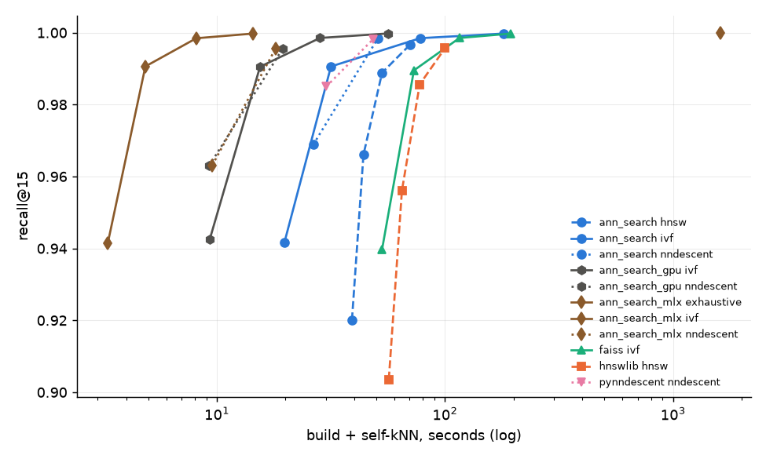

## Self-kNN on single-cell PCA

What this crate was written for: you have a PCA embedding of a few million
cells and need its kNN graph for clustering, UMAP and friends, as fast as
possible. So the clock covers the whole job, build plus every cell queried
against all cells, and the question is how long it takes to reach a given
recall.

Run via the Python bindings (from `benchmarks/`):

```bash
uv run selfknn.py run --threads 10
uv run selfknn.py summarise
```

### Data

The first 32 principal components of one plate of Tahoe-100M: 2,857,393
cells, Euclidean. Real data, so the cluster structure and density variation are
what a pipeline actually sees, not a synthetic stand-in.

The file `tahoe-pca-32-euclidean.hdf5` (349 MB) carries the PCs as `train`,
plus exact ground truth for 10,000 randomly drawn cells (`test_ids`): their
100 nearest neighbours by squared Euclidean distance against all cells, self
included, computed in float64. `selfknn.py` downloads it on first use.

### Setup

- **k = 15**, the usual single-cell default. Recall@15 is the overlap of
  neighbour ids on the 10,000 ground-truth rows of the self-kNN graph, self
  included.
- **NN-Descent** rows are the graph the build converged on, read back without
  a search pass (`extract_knn`), at graph degree 15 and 30. That is the
  single-cell path. pynndescent runs exactly as `sc.pp.neighbors` drives it by
  default (UMAP's settings: degree 16 counting self, `n_trees = min(64, 5 +
  round(sqrt(n) / 20))`, `n_iters = round(log2(n))`), reading its build graph
  the same way, plus the same at degree 30.
- **HNSW** at M = 16 and ef_construction = 100 (ann-search, hnswlib), self-query
  swept over `ef_search` 16 to 128.
- **IVF** at `nlist = sqrt(n)` (ann-search CPU, wgpu and MLX, faiss
  `IndexIVFFlat`), self-query swept over `nprobe` 4 to 32.
- **Exact** is the MLX exhaustive index, as the floor every approximate method
  has to beat on time.
- **Timing:** one untimed warm-up on 5,000 random points per method (imports,
  numba JIT, kernel compilation), then a single timed build and a single timed
  self-query per sweep point. Each method runs in its own process. *Peak* is
  the process's peak memory above the baseline taken after the data loaded.

### Results

The fastest build plus self-kNN, in seconds, at which each method reaches the
recall target. `n/a` means no point on its sweep got there.



| Method | Library | Peak (MiB) | Total (s) @ 0.90 | Total (s) @ 0.95 | Total (s) @ 0.99 |
|---|---|---:|---:|---:|---:|
| ivf | **ann_search_mlx** | 6,155 | 3.3 | 4.9 | 4.9 |
| nndescent | **ann_search_gpu** | 20,773 | 9.3 | 9.3 | 19.4 |
| ivf | **ann_search_gpu** | 7,119 | 9.3 | 15.5 | 15.5 |
| nndescent | **ann_search_mlx** | 33,708 | 9.5 | 9.5 | 18.1 |
| ivf | **ann_search** | 1,408 | 19.8 | 31.6 | 31.6 |
| nndescent | **ann_search** | 6,946 | 26.5 | 26.5 | 50.8 |
| nndescent | pynndescent | 10,707 | 30.2 | 30.2 | 48.5 |
| hnsw | **ann_search** | 2,107 | 39.1 | 43.9 | 70.0 |
| ivf | faiss | 2,480 | 52.9 | 73.1 | 115.8 |
| hnsw | hnswlib | 2,398 | 56.7 | 64.7 | 100.0 |
| exhaustive | **ann_search_mlx** | 6,837 | 1606.7 | 1606.7 | 1606.7 |

### Caveats

- `ann_search_gpu` and `ann_search_mlx` run on the M1 Max's integrated GPU.
  Memory is unified, so their peak includes the device buffers.
- One timed run per point. Read small gaps as ties.

---

### Runtime info

*ann-search-rs 0.11.0 (commit v0.10.1-65-g0a48e98), run on 2026-10-11 on Apple M1 Max. Runs span commits v0.10.1-65-g0a48e98, v0.10.1-66-gc83e6d5.*
*All benchmarks were run on M1 Max MacBook Pro with 64 GB unified memory.*
